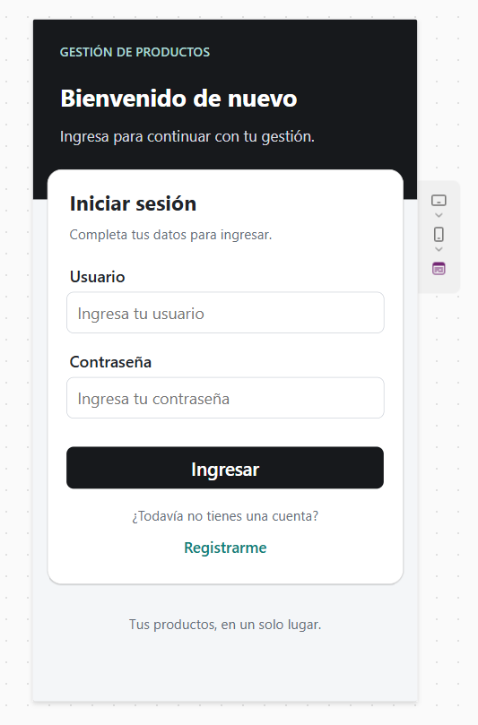
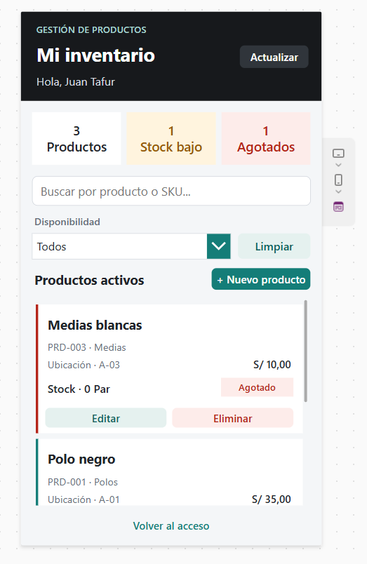
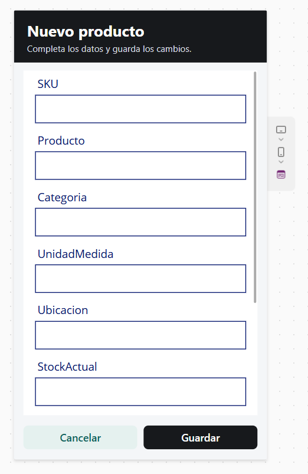
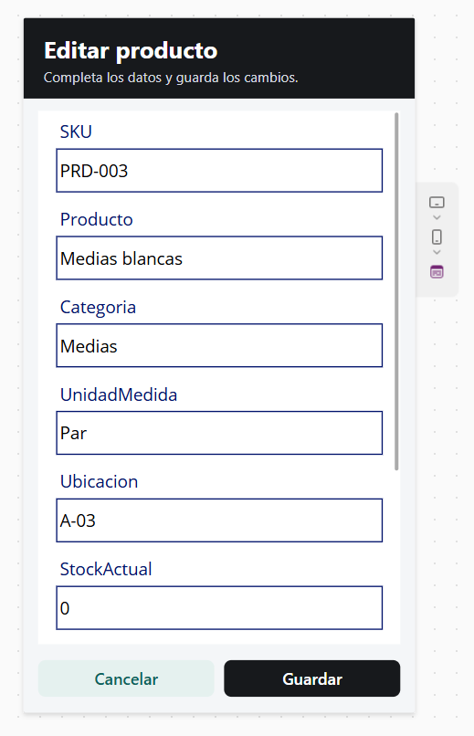
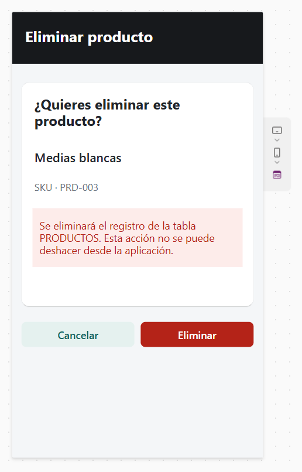
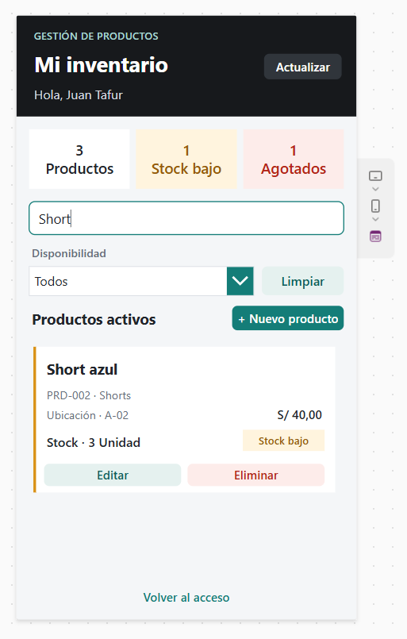
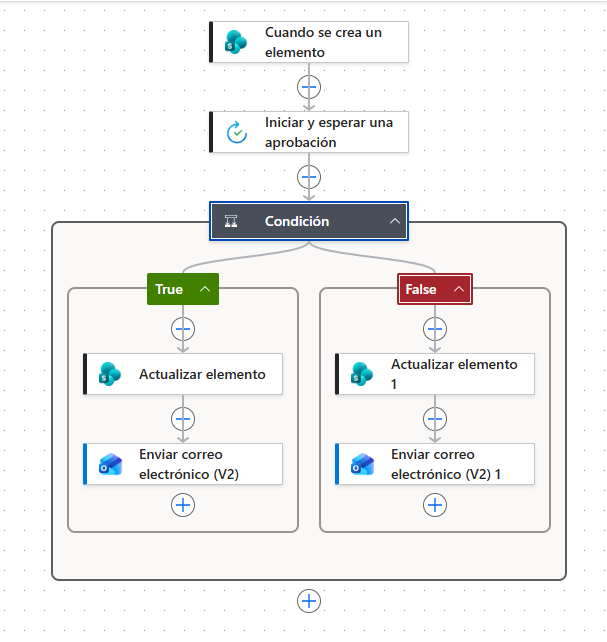

# 📦 Power Apps Inventory Management

Aplicación de gestión de inventario desarrollada con **Microsoft Power Apps** y **Power Automate**.  
El proyecto permite administrar productos, consultar el estado del stock y automatizar un proceso de aprobación y notificación.

## 🚀 Funcionalidades

- Inicio de sesión de usuarios.
- Visualización general del inventario.
- Indicadores de productos, stock bajo y productos agotados.
- Búsqueda de productos por nombre o SKU.
- Filtro por disponibilidad.
- Registro de nuevos productos.
- Edición de productos existentes.
- Eliminación de productos con confirmación.
- Control de SKU, categoría, unidad de medida, ubicación y stock.
- Automatización de aprobaciones mediante Power Automate.
- Actualización de registros y envío de correos según el resultado de la aprobación.

## 🛠️ Tecnologías utilizadas

- Microsoft Power Apps
- Microsoft Power Automate
- SharePoint
- Microsoft 365

## 📱 Capturas de la aplicación

### Inicio de sesión


### Gestión de inventario


### Registro de un nuevo producto


### Edición de producto


### Eliminación de producto


### Búsqueda y control de stock


## ⚙️ Automatización con Power Automate

El proyecto incorpora un flujo que se ejecuta cuando se crea un elemento en SharePoint.  
El flujo inicia una aprobación y, de acuerdo con el resultado, actualiza el elemento y envía una notificación por correo electrónico.



## 📂 Estructura sugerida del repositorio

```text
powerapps-inventory-management/
├── README.md
├── app/
│   └── GestionInventarioPowerApps_v1.0.zip
├── screenshots/
│   ├── 01-login.png
│   ├── 02-inventario.png
│   ├── 03-nuevo-producto.png
│   ├── 04-editar-producto.png
│   ├── 05-eliminar-producto.png
│   ├── 06-busqueda-filtro.png
│   └── 07-power-automate-aprobacion.png
└── docs/
```

## 📌 Objetivo del proyecto

Desarrollar una solución de gestión de inventario que permita centralizar la información de los productos y facilitar tareas operativas mediante una interfaz sencilla y automatizaciones con Microsoft Power Platform.

## 👨‍💻 Autor

**Juan Tafur**

Proyecto desarrollado como parte de mi aprendizaje y portafolio profesional en **Power Platform, automatización de procesos y desarrollo de soluciones empresariales**.
